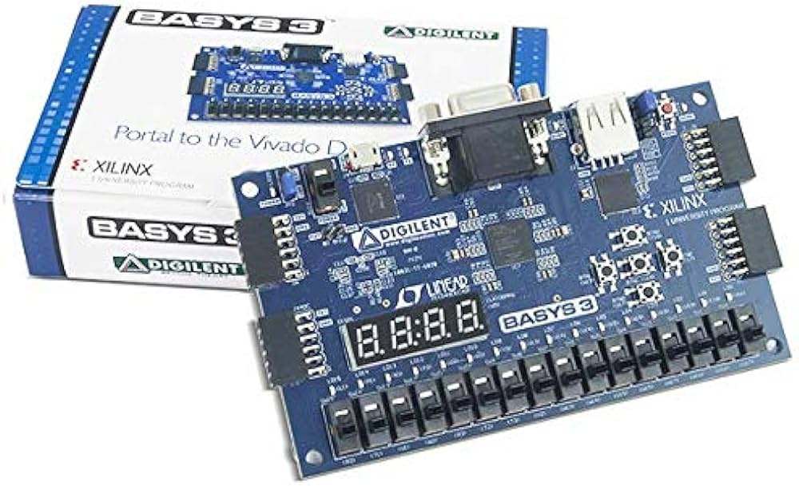
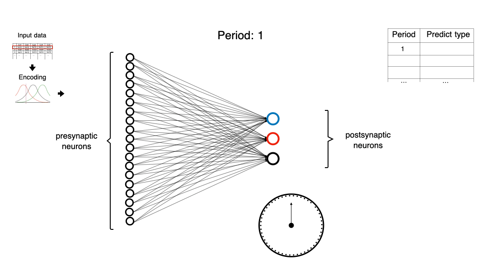
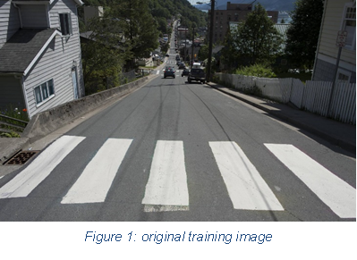
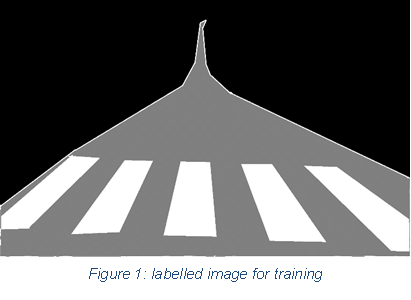
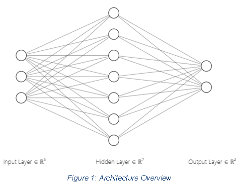
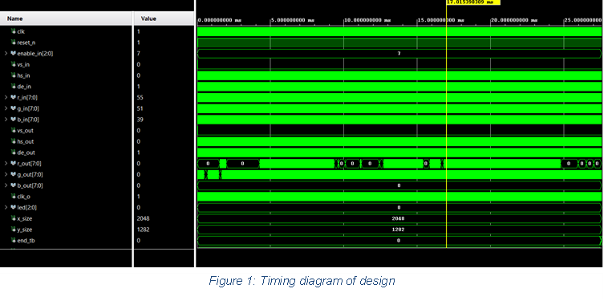
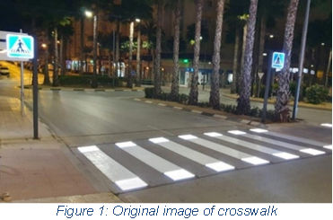
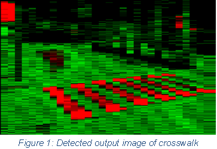

<div align="center">

# Spiking Neural Network on FPGA

**Real-time crosswalk detection with a spiking neural network, written in VHDL and running on a Basys3 FPGA.**

[](https://buymeacoffee.com/imshaaz)




</div>

## Overview

A Spiking Neural Network (SNN) mimics how biological neurons fire. That makes it a good fit for low-power embedded systems. This project implements one in VHDL on an FPGA, so it processes video pixels in hardware, in parallel, as they arrive.

The network is trained offline (Octave, then Python for weight normalization) and the weights are loaded into the VHDL design. It is tuned for color detection, to tell **crosswalk** (white) from **road** (dark) areas.

<div align="center">

<br>
<sub>Source: <a href="https://medium.com/@tapwi93/first-steps-in-spiking-neural-networks-da3c82f538ad">Medium</a></sub>
</div>

## How it works

```
Octave training  ->  Python normalization  ->  VHDL weights  ->  Vivado synthesis  ->  Basys3
 (ANN, ReLU)         (fixed point, 8-bit)      (SNN, 64 steps)
```

| Stage | What happens |
| --- | --- |
| **Train** | A small ReLU network is trained in Octave on labelled images. |
| **Convert** | Python normalizes the weights and converts them to fixed point (`2^8`) for VHDL. |
| **Input** | Real images are read as PPM, so each pixel maps straight onto the design's 8-bit R, G, B inputs. |
| **Run** | Each pixel is evaluated over 64 steps. The output appears after 64 cycles, which produces the block-like structure in the result image. |

> **PPM** (Portable Pixel Map) is a simple, human-readable image format from the Netpbm toolkit. It is supported by most image tools.

| Training image | Labelled image |
| --- | --- |
|  |  |

## Architecture

- **Input layer:** 3 inputs (R, G, B)
- **Hidden layer:** 7 neurons
- **Output layer:** 2 nodes (white detection)

Top module `snn_rgb`, built from three modules:

| Module | Role |
| --- | --- |
| `control` | Sequences the 64 steps per pixel |
| `gen_input` | Generates the spike input from pixel values |
| `neuron` | The spiking neuron |



Target device: Xilinx Artix-7 `xc7a35tcpg236-1` (Basys3). A 74.25 MHz clock drives 720p video input.

## Results



| Test image | Output image |
| --- | --- |
|  |  |

- Road and similarly dark areas are marked **green**.
- The white crosswalk is marked **red**.
- Some other regions also show red because they are close to white.
- The visible blocks come from the 64-cycle evaluation per pixel.

## Repository layout

```
.
|-- SNN-RGB/              Vivado project (VHDL sources, constraints, simulation)
|-- Sources/
|   |-- Octave/           training and accuracy scripts
|   |-- Py Scripts/       weight normalization and fixed-point conversion
|   |-- Schematic/        schematic.pdf
|   `-- images/
`-- README.md
```

## Getting started

**Hardware:** Basys3 board, Vivado 2023.2.

1. Open `SNN-RGB/SNN-RGB.xpr` in Vivado.
2. Run synthesis and implementation, then program the board.
3. The top module exposes three slide-switch inputs (`enable_in`); see `constraints.xdc` for the pin mapping.

**Regenerate weights:**

```bash
pip install numpy opencv-python
cd "Sources/Py Scripts"
python main.py        # reads test.png, writes SNN parameters for VHDL
```

Training uses the Octave scripts in `Sources/Octave/` (`Spiking_NN_RGB_3_Categories.m`).

## Future work

- Fix the block-like artifact caused by the 64-cycle evaluation, or find a faster alternative.
- Process video frames at high speed.
- Use the same technique to alert drivers when a traffic light changes color.

## Credits

Built for **CS4362 Hardware Description Languages** by [imshaaz21](https://github.com/imshaaz21) and [sarraj-sareef](https://github.com/sarraj-sareef).

The Python scripts and design approach build on:
1. [Marco-Winzker/Spiking_NN_RGB_FPGA](https://github.com/Marco-Winzker/Spiking_NN_RGB_FPGA)
2. [antimattercorrade/Color_Detection_BASYS3](https://github.com/antimattercorrade/Color_Detection_BASYS3)
3. [fpga4student: load a text file to FPGA](https://www.fpga4student.com/2016/11/two-ways-to-load-text-file-to-fpga-or.html)

## Support

If this project helped you, you can [buy me a coffee](https://buymeacoffee.com/imshaaz).
